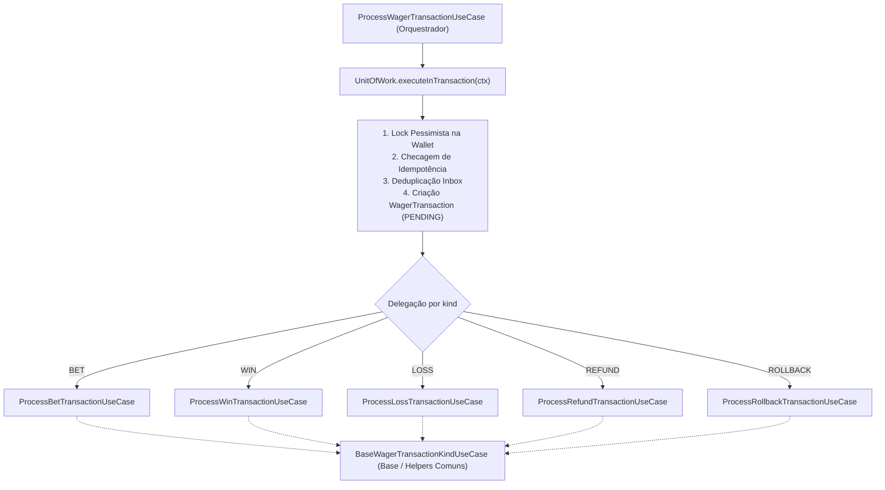

# Arquitetura — Distributed Wagering Processor

Este documento descreve as decisões de arquitetura, padrões de projeto, garantias de concorrência, consistência contábil e trade-offs adotados na implementação do **Distributed Wagering Processor**.

---

## 1. Princípios e Estrutura Arquitetural

A aplicação foi estruturada segundo os princípios de **Clean Architecture / Hexagonal Architecture (Ports and Adapters)** combinados com **Domain-Driven Design (DDD)**:

```text
src/
├── domain/            # Núcleo de Domínio Puro (Zero acoplamento com frameworks ou ORM)
│   ├── shared/        # Value Objects (Money, Canonical JSON Hash)
│   ├── wallet/        # Agregado Wallet, Entidade WalletLedgerEntry
│   ├── wagering/      # Agregado WagerTransaction, Enums, FailureCodes
│   └── messaging/     # InboxMessage, OutboxMessage, IntegrationEvent
├── application/       # Camada de Aplicação (Casos de Uso, Portas e DTOs)
│   ├── ports/         # Interfaces dos repositórios e Unit of Work
│   ├── dtos/          # Contratos validados com class-validator
│   └── use-cases/     # Orquestração de negócio e controle transacional
│       └── wager-kinds/ # Use Cases especializados por tipo de transação (BET, WIN, LOSS, REFUND, ROLLBACK)
└── infrastructure/    # Adaptadores Técnicos e Infraestrutura
    ├── persistence/   # TypeORM (Data Mapper), Migrations PostgreSQL
    ├── messaging/     # AWS SQS FIFO com LocalStack, Workers Outbox/Inbox
    ├── http/          # Controllers NestJS, Filtros, Interceptors
    └── config/        # Leitura tipada de variáveis de ambiente
```

### Isolamento do Domínio Puro
As entidades de domínio (`Wallet`, `WagerTransaction`, `WalletLedgerEntry`) não utilizam decorators do NestJS nem do TypeORM. A persistência adota o padrão **Data Mapper** via entidades ORM separadas (`WalletOrmEntity`, etc.), garantindo que as regras de negócio permaneçam 100% testáveis em memória sem necessidade de infraestrutura pesada.

### Orquestração do Pipeline Transacional e Delegação por `kind`
O caso de uso `ProcessWagerTransactionUseCase` atua como um **Orquestrador do Pipeline Transacional** (responsável por telemetria, abertura de transação via `UnitOfWork`, lock pessimista da carteira, verificação de idempotência, deduplicação via *Transactional Inbox* e instanciação inicial de `WagerTransaction`) e delega a execução da regra de negócio de cada tipo (`WagerTransactionKind`) para **Use Cases especializados** que operam dentro do mesmo `TransactionalContext` já aberto e com a carteira bloqueada:



> **Garantia de Atomicidade e Lock Pessimista:** Os Use Cases específicos por `kind` recebem o `TransactionalContext` (`ctx`), a `Wallet` já bloqueada com `pessimistic_write` e a instância de `WagerTransaction`. Assim, todas as operações de cada tipo executam **na mesma transação de banco de dados**, sem abrir transações aninhadas nem perder o lock pessimista.

---

## 2. Correção Financeira e Representação Monetária

1. **Proibição de Ponto Flutuante**:
   - É terminantemente proibido o uso de `number`, `float` ou `double` para cálculos financeiros.
   - Todo valor monetário é modelado pelo Value Object imutável `Money`, baseado na biblioteca de precisão arbitrária `decimal.js`.
   - Escala fixa de **2 casas decimais** (`toFixed(2)`), serializado como string decimal (ex: `"25.00"`).
   - O schema do banco armazena em colunas `NUMERIC(18, 2)` com código de moeda ISO-4217 (`VARCHAR(3)`).
2. **Saldo Não Negativo**:
   - Garantido em nível de domínio (`wallet.debit` valida `balance >= amount`).
   - Imutável em nível de banco via constraint `CONSTRAINT chk_wallets_balance_non_negative CHECK (balance_amount >= 0)`.
3. **Imutabilidade Estrutural do Ledger**:
   - Cada movimentação financeira que altera saldo produz exatamente um lançamento em `wallet_ledger_entries`.
   - A entidade `WalletLedgerEntry` é estruturalmente imutável (sem setters nem métodos de mutação).
   - A constraint do banco `CONSTRAINT chk_ledger_balanced` valida a equação aritmética contábil: `balance_before ± amount === balance_after`.
   - Um trigger nativo do PostgreSQL (`trg_prevent_ledger_mutation`) bloqueia qualquer tentativa física de `UPDATE` ou `DELETE` no ledger.
4. **Reconciliação Contábil**:
   - O caso de uso `ReconcileWalletUseCase` recalcula o saldo real somando os lançamentos contábeis (`SUM(CREDIT) - SUM(DEBIT)`) e compara com o saldo materializado corrente.
   - Divergências são logadas estruturadamente para auditoria.

---

## 3. Concorrência e Ordenação Distribuída

1. **Unidade de Concorrência**:
   - A unidade de concorrência é o `walletId`.
2. **Estratégia de Concorrência**:
   - **Lock Pessimista (`pessimistic_write` -> `SELECT ... FOR UPDATE`)**:
     Ao processar qualquer transação de aposta, a carteira é buscada com lock pessimista dentro da transação atômica do PostgreSQL.
   - Isso serializa todas as operações concorrentes na mesma carteira, prevenindo completamente *Lost Updates*, *Read Skews* e corridas por saldo insuficiente.
   - Wallets diferentes executam em paralelo sem nenhum bloqueio mútuo.
3. **Tratamento de Race Conditions em Múltiplas Instâncias**:
   - Caso duas requisições idênticas compitam antes do lock, a constraint única `uq_wager_tx_provider_external` / `uq_wager_tx_idempotency_key` garante atomicidade no commit.
   - O caso de uso captura o erro PostgreSQL `23505` (Unique Violation) e re-executa a leitura da transação recém-comitada, retornando o resultado original com `idempotentReplay: true`.

---

## 4. Idempotência Persistente e Integridade de Payload

1. **Fonte da Verdade**:
   - O header HTTP `Idempotency-Key` (ou campo equivalente na mensagem SQS) é obrigatório.
2. **Hash Canônico de Negócio**:
   - Um utilitário de ordenação recursiva de chaves calcula o hash SHA-256 do JSON de negócio (`providerId`, `externalTransactionId`, `playerId`, `walletId`, `roundId`, `gameId`, `kind`, `money`, `referenceExternalTransactionId`).
3. **Resolução de Conflitos**:
   - **Replay Idêntico**: Mesma chave com o mesmo hash retorna exatamente o estado original registrado, com `idempotentReplay: true`.
   - **Conflito de Payload**: Mesma chave com payload de negócio divergente é rejeitada imediatamente com `HTTP 409 Conflict` e failure code `IDEMPOTENCY_PAYLOAD_MISMATCH`.

---

## 5. Padrões de Mensageria: Transactional Inbox e Outbox

1. **Transactional Inbox**:
   - Mensagens recebidas da fila AWS SQS FIFO (`wager-transactions.fifo`) registram a tupla `(consumerName, messageId)` na tabela `inbox_messages` dentro da **mesma transação SQL** da operação financeira.
   - Se a mensagem for redelineada pelo SQS (redelivery), a chave primária composta impede o reprocessamento duplicado.
   - O `ACK` (`DeleteMessageCommand`) é enviado ao SQS **exclusivamente após o commit** bem-sucedido no PostgreSQL.
2. **Transactional Outbox**:
   - Toda alteração de saldo ou mudança de estado de transação grava um evento na tabela `outbox_messages` na mesma transação atômica.
   - O worker `OutboxPublisherJob` roda periodicamente consultando mensagens pendentes via:
     ```sql
     SELECT * FROM outbox_messages
     WHERE published_at IS NULL
       AND (next_attempt_at IS NULL OR next_attempt_at <= NOW())
     ORDER BY occurred_at ASC
     LIMIT 50
     FOR UPDATE SKIP LOCKED;
     ```
   - O uso de `FOR UPDATE SKIP LOCKED` permite escalar para **múltiplas instâncias do worker** sem disputa nem duplicação de locks.
   - Em caso de falha de conexão com a AWS, é aplicado backoff exponencial (`scheduleRetry`).
3. **Resolução de Referências Fora de Ordem (`PENDING_REFERENCE`)**:
   - Operações `REFUND` e `ROLLBACK` cuja transação original ainda não foi recebida são salvas em estado `PENDING_REFERENCE`.
   - O job `PendingReferencesJob` reprocessa essas operações periodicamente.
   - Ao atingir o limite de tempo configurado (TTL de 10 minutos), a transação é transicionada para `REJECTED` com `REFERENCE_NOT_FOUND`.

---

## 6. Autenticação e Fronteiras de Segurança

Conforme a seção 2 do escopo:
- Mensagens originadas das filas SQS FIFO são consideradas canal interno confiável.
- Endpoints de health checks (`/health/live` e `/health/ready`) são públicos e livres de autenticação.
- O sistema está preparado para autenticação via Identity Provider externo (Keycloak/Zitadel/OAuth2/OIDC) através de Guards do NestJS sem impacto nas invariantes de domínio.
