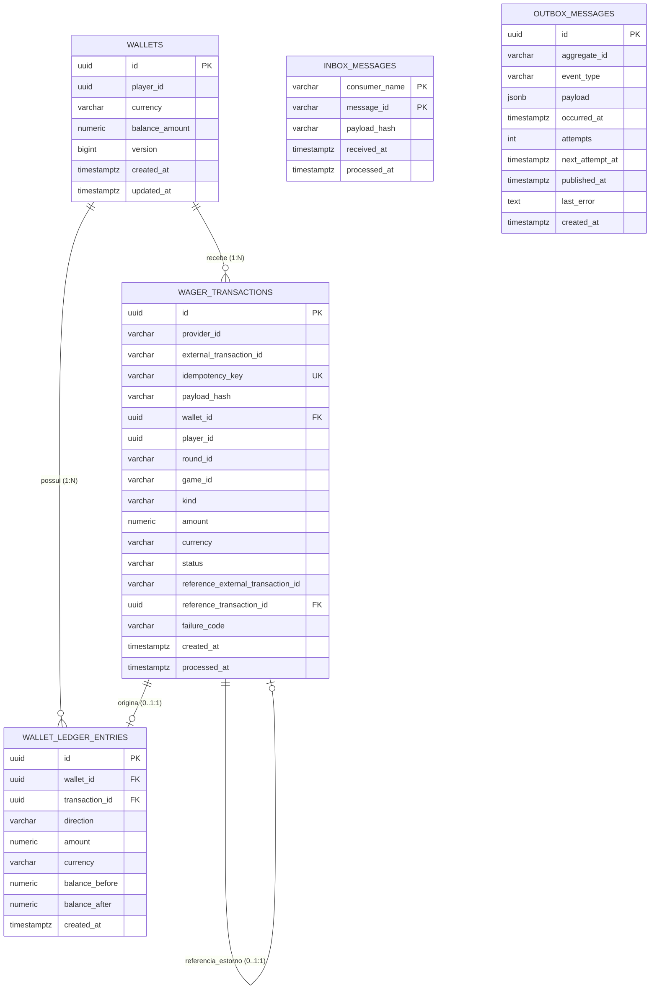

# Modelagem de Banco de Dados — Distributed Wagering Processor

Este documento define a especificação completa do modelo de dados relacional para o **Distributed Wagering Processor**, implementado sobre **PostgreSQL 16** e gerenciado via **TypeORM**.

O design do schema reflete estritamente os requisitos de **correção financeira**, **concorrência distribuída**, **idempotência persistente**, **auditabilidade imutável** e os padrões **Transactional Inbox** e **Transactional Outbox**, conforme estabelecido em [project-scope.md](file:///c:/Users/jesse/portfolio/repos/pay-challenge/docs/project-scope.md) e [step-by-step-implementation.md](file:///c:/Users/jesse/portfolio/repos/pay-challenge/docs/step-by-step-implementation.md).

---

## 1. Princípios Arquiteturais e Invariantes no Schema

O desafio impõe a restrição mandatória de que as garantias de unicidade, imutabilidade e não-negatividade **sejam impostas pelo próprio schema do PostgreSQL**, e não apenas delegadas à camada da aplicação.

1. **Precisão Monetária Sem Ponto Flutuante**:
   - É proibido o uso de `FLOAT`, `REAL` ou `DOUBLE PRECISION`.
   - Todas as grandezas financeiras utilizam `NUMERIC(18, 2)` (escala fixa de 2 casas decimais) associadas a uma coluna de moeda `VARCHAR(3)` (código ISO-4217, ex: `BRL`).
2. **Saldo Não Negativo**:
   - A tabela `wallets` possui constraint `CHECK (balance_amount >= 0)`.
   - Nenhuma transação pode violar essa restrição, garantindo integridade mesmo em condições de alta concorrência.
3. **Imutabilidade Estrutural do Ledger (Append-Only)**:
   - A tabela `wallet_ledger_entries` nunca sofre `UPDATE` ou `DELETE`.
   - Cada linha possui uma constraint aritmética estrita: `balance_before ± amount = balance_after`.
   - Um gatilho (*trigger*) de banco bloqueia fisicamente qualquer tentativa de modificação ou deleção acidental.
4. **Idempotência Persistente e Integridade de Payload**:
   - Transações registram `idempotency_key` única e `payload_hash` (SHA-256 do JSON canônico de negócio) para diferenciar repetições idênticas (*idempotent replay*) de conflitos com payload modificado.
   - Unicidade garantida por chave composta `(provider_id, external_transaction_id)`.
5. **Prevenção de Reversão Dupla a Nível de Banco**:
   - Um índice único parcial impede que uma mesma transação referenciada sofra mais de um `REFUND` ou `ROLLBACK` processado.
6. **Consistência Atômica com Inbox e Outbox**:
   - `inbox_messages`, `wallets`, `wager_transactions`, `wallet_ledger_entries` e `outbox_messages` são gravados e comitados na **mesma transação SQL**.

---

## 2. Diagrama Entidade-Relacionamento (ERD)



---

## 3. Especificação Detalhada das Tabelas e Campos

### 3.1 Tabela `wallets`

Representa o **Aggregate Root** da carteira do jogador. O saldo materializado permite leituras ultrarrápidas de saldo e locks atômicos por carteira (`wallet_id`).

| Campo | Tipo SQL | Nulo | Default | Descrição |
|---|---|---|---|---|
| `id` | `UUID` | **NÃO** | — | Identificador primário único da carteira (UUIDv7/UUIDv4). |
| `player_id` | `UUID` | **NÃO** | — | Identificador externo do jogador associado. |
| `currency` | `VARCHAR(3)` | **NÃO** | `'BRL'` | Código da moeda no padrão ISO-4217 (ex: `BRL`, `USD`). |
| `balance_amount` | `NUMERIC(18, 2)` | **NÃO** | `0.00` | Saldo materializado corrente da carteira. |
| `version` | `BIGINT` | **NÃO** | `1` | Versão de controle de concorrência otimista. Incrementado exclusivamente em alterações de saldo. |
| `created_at` | `TIMESTAMPTZ` | **NÃO** | `CURRENT_TIMESTAMP` | Data/hora UTC de criação do registro. |
| `updated_at` | `TIMESTAMPTZ` | **NÃO** | `CURRENT_TIMESTAMP` | Data/hora UTC da última atualização. |

#### Constraints e Regras de Integridade:
- **Chave Primária**: `CONSTRAINT pk_wallets PRIMARY KEY (id)`
- **Unicidade de Carteira**: `CONSTRAINT uq_wallets_player_currency UNIQUE (player_id, currency)`
  - *Regra de Negócio*: No máximo uma wallet por jogador e moeda.
- **Não-Negatividade de Saldo**: `CONSTRAINT chk_wallets_balance_non_negative CHECK (balance_amount >= 0)`
  - *Regra Inviolável*: O banco rejeita imediatamente qualquer tentativa de débito que resulte em saldo inferior a zero.
- **Versão Positiva**: `CONSTRAINT chk_wallets_version_positive CHECK (version >= 1)`

#### Índices:
- `pk_wallets` em `(id)` (automático).
- `uq_wallets_player_currency` em `(player_id, currency)` (automático).

---

### 3.2 Tabela `wager_transactions`

Representa o ciclo de vida e a auditoria de cada intenção de aposta recebida dos provedores de jogos.

| Campo | Tipo SQL | Nulo | Default | Descrição |
|---|---|---|---|---|
| `id` | `UUID` | **NÃO** | — | Identificador interno da transação no sistema. |
| `provider_id` | `VARCHAR(64)` | **NÃO** | — | Identificador do provedor emissor (ex: `provider-a`). |
| `external_transaction_id` | `VARCHAR(128)` | **NÃO** | — | ID original da transação atribuído pelo provedor. |
| `idempotency_key` | `VARCHAR(255)` | **NÃO** | — | Chave de idempotência (header HTTP ou envelope da fila). |
| `payload_hash` | `VARCHAR(64)` | **NÃO** | — | Hash SHA-256 do JSON canônico com os dados de negócio. |
| `wallet_id` | `UUID` | **NÃO** | — | FK da carteira impactada. |
| `player_id` | `UUID` | **NÃO** | — | ID do jogador proprietário. |
| `round_id` | `VARCHAR(128)` | **NÃO** | — | Identificador da rodada da aposta. |
| `game_id` | `VARCHAR(128)` | **NÃO** | — | Identificador do jogo no provedor (ex: `fortune-chimp`). |
| `kind` | `VARCHAR(20)` | **NÃO** | — | Tipo da operação: `OPENING`, `BET`, `WIN`, `LOSS`, `REFUND`, `ROLLBACK`. |
| `amount` | `NUMERIC(18, 2)` | **NÃO** | — | Valor monetário nominal da transação. |
| `currency` | `VARCHAR(3)` | **NÃO** | `'BRL'` | Código da moeda ISO-4217. |
| `status` | `VARCHAR(20)` | **NÃO** | `'PENDING'` | Estado atual: `PENDING`, `PENDING_REFERENCE`, `PROCESSED`, `REJECTED`, `FAILED`. |
| `reference_external_transaction_id` | `VARCHAR(128)` | SIM | `NULL` | ID externo da transação a ser revertida/referenciada (obrigatório para `REFUND`/`ROLLBACK`). |
| `reference_transaction_id` | `UUID` | SIM | `NULL` | FK resolvida internamente para a transação referenciada. |
| `failure_code` | `VARCHAR(64)` | SIM | `NULL` | Código legível por máquina em caso de rejeição ou falha (ex: `INSUFFICIENT_FUNDS`). |
| `created_at` | `TIMESTAMPTZ` | **NÃO** | `CURRENT_TIMESTAMP` | Data/hora UTC de recepção e gravação inicial. |
| `processed_at` | `TIMESTAMPTZ` | SIM | `NULL` | Data/hora UTC em que a transação atingiu um estado terminal. |

#### Constraints e Regras de Integridade:
- **Chave Primária**: `CONSTRAINT pk_wager_transactions PRIMARY KEY (id)`
- **Chave Estrangeira de Wallet**: `CONSTRAINT fk_wager_tx_wallet FOREIGN KEY (wallet_id) REFERENCES wallets(id) ON DELETE RESTRICT`
- **Chave Estrangeira Auto-relacionada (Referência)**: `CONSTRAINT fk_wager_tx_reference FOREIGN KEY (reference_transaction_id) REFERENCES wager_transactions(id) ON DELETE RESTRICT`
- **Unicidade de Identificação do Provedor**: `CONSTRAINT uq_wager_tx_provider_external UNIQUE (provider_id, external_transaction_id)`
- **Unicidade de Chave de Idempotência**: `CONSTRAINT uq_wager_tx_idempotency_key UNIQUE (idempotency_key)`
- **Valores Permitidos para Kind**: `CONSTRAINT chk_wager_tx_kind CHECK (kind IN ('OPENING', 'BET', 'WIN', 'LOSS', 'REFUND', 'ROLLBACK'))`
- **Valores Permitidos para Status**: `CONSTRAINT chk_wager_tx_status CHECK (status IN ('PENDING', 'PENDING_REFERENCE', 'PROCESSED', 'REJECTED', 'FAILED'))`
- **Valor Não-Negativo**: `CONSTRAINT chk_wager_tx_amount_positive CHECK (amount >= 0)`

#### Índices Otimizados:
- `idx_wager_tx_wallet_created`: `(wallet_id, created_at DESC)` — Histórico por carteira.
- `idx_wager_tx_round_player`: `(round_id, player_id)` — Validação de rodada.
- `idx_wager_tx_pending_reference`: Índice parcial `(created_at ASC) WHERE status = 'PENDING_REFERENCE'` — Polling rápido do worker de reprocessamento com backoff.
- `uq_wager_tx_single_reversal`: Índice único parcial `UNIQUE (reference_transaction_id, kind) WHERE reference_transaction_id IS NOT NULL AND status = 'PROCESSED'` — Garante que uma aposta nunca sofra múltiplos `REFUND` ou `ROLLBACK` com sucesso.

---

### 3.3 Tabela `wallet_ledger_entries`

Representa o **livro contábil imutável (Ledger)** de todas as movimentações financeiras efetivas. Toda alteração de saldo em `wallets` exige exatamente um lançamento correspondente nesta tabela.

| Campo | Tipo SQL | Nulo | Default | Descrição |
|---|---|---|---|---|
| `id` | `UUID` | **NÃO** | — | Identificador único do lançamento contábil. |
| `wallet_id` | `UUID` | **NÃO** | — | FK da carteira movimentada. |
| `transaction_id` | `UUID` | **NÃO** | — | FK da transação financeira originária. |
| `direction` | `VARCHAR(10)` | **NÃO** | — | Sentido do fluxo financeiro: `'DEBIT'` ou `'CREDIT'`. |
| `amount` | `NUMERIC(18, 2)` | **NÃO** | — | Valor estritamente positivo movimentado. |
| `currency` | `VARCHAR(3)` | **NÃO** | `'BRL'` | Código da moeda ISO-4217. |
| `balance_before` | `NUMERIC(18, 2)` | **NÃO** | — | Saldo imediatamente anterior ao lançamento. |
| `balance_after` | `NUMERIC(18, 2)` | **NÃO** | — | Saldo resultante após a aplicação do lançamento. |
| `created_at` | `TIMESTAMPTZ` | **NÃO** | `CURRENT_TIMESTAMP` | Data/hora UTC exata da efetivação do lançamento. |

#### Constraints e Regras de Integridade:
- **Chave Primária**: `CONSTRAINT pk_wallet_ledger_entries PRIMARY KEY (id)`
- **Chave Estrangeira de Wallet**: `CONSTRAINT fk_ledger_wallet FOREIGN KEY (wallet_id) REFERENCES wallets(id) ON DELETE RESTRICT`
- **Chave Estrangeira de Transação**: `CONSTRAINT fk_ledger_transaction FOREIGN KEY (transaction_id) REFERENCES wager_transactions(id) ON DELETE RESTRICT`
- **Unicidade de Transação por Wallet**: `CONSTRAINT uq_ledger_wallet_transaction UNIQUE (wallet_id, transaction_id)`
  - *Regra Inviolável*: Uma transação financeira produz **no máximo um lançamento por wallet**.
- **Sentido Contábil Válido**: `CONSTRAINT chk_ledger_direction CHECK (direction IN ('DEBIT', 'CREDIT'))`
- **Valor Movimentado Estritamente Positivo**: `CONSTRAINT chk_ledger_amount_positive CHECK (amount > 0)`
- **Saldos Não Negativos**: `CONSTRAINT chk_ledger_balances_non_negative CHECK (balance_before >= 0 AND balance_after >= 0)`
- **Equação Aritmética Contábil no Banco**:
  ```sql
  CONSTRAINT chk_ledger_balanced CHECK (
    (direction = 'CREDIT' AND balance_after = balance_before + amount) OR
    (direction = 'DEBIT'  AND balance_after = balance_before - amount)
  )
  ```
  - *Garantia Inviolável*: O banco de dados recusa qualquer divergência entre `balance_before`, `amount` e `balance_after`.

#### Imutabilidade Garantida (Append-Only Trigger):
- Bloqueio explícito de `UPDATE` e `DELETE` via trigger em PostgreSQL para assegurar que lançamentos contábeis nunca sejam adulterados ou excluídos.

#### Índices Otimizados:
- `idx_ledger_wallet_cursor`: `(wallet_id, created_at DESC, id DESC)` — Suporta o endpoint de extrato paginado via cursor estável (`GET /wallets/:walletId/ledger`).

---

### 3.4 Tabela `inbox_messages`

Implementa o padrão **Transactional Inbox** para garantir a entrega *at-least-once* idempotente de mensagens consumidas do AWS SQS FIFO.

| Campo | Tipo SQL | Nulo | Default | Descrição |
|---|---|---|---|---|
| `consumer_name` | `VARCHAR(64)` | **NÃO** | — | Nome do serviço/consumidor (ex: `wager-transactions-consumer`). |
| `message_id` | `VARCHAR(128)` | **NÃO** | — | ID único da mensagem gerado pelo SQS ou emissor. |
| `payload_hash` | `VARCHAR(64)` | **NÃO** | — | Hash SHA-256 do corpo da mensagem recebida para auditoria. |
| `received_at` | `TIMESTAMPTZ` | **NÃO** | `CURRENT_TIMESTAMP` | Data/hora UTC do recebimento da mensagem. |
| `processed_at` | `TIMESTAMPTZ` | SIM | `NULL` | Data/hora UTC em que o processamento transacional foi finalizado com sucesso. |

#### Constraints e Regras de Integridade:
- **Chave Primária Composta**: `CONSTRAINT pk_inbox_messages PRIMARY KEY (consumer_name, message_id)`
  - *Deduplicação Nativa*: Se o SQS entregar a mesma mensagem duas vezes, a segunda inserção concorrente falhará por chave duplicada dentro da transação, protegendo o processamento.

---

### 3.5 Tabela `outbox_messages`

Implementa o padrão **Transactional Outbox**. Eventos de domínio são persistidos na mesma transação atômica das operações de saldo e ledger, sendo posteriormente despachados para o broker por um worker assíncrono.

| Campo | Tipo SQL | Nulo | Default | Descrição |
|---|---|---|---|---|
| `id` | `UUID` | **NÃO** | — | Identificador único do evento na outbox. |
| `aggregate_id` | `VARCHAR(64)` | **NÃO** | — | ID do agregado que originou o evento (ex: `wallet_id`). |
| `event_type` | `VARCHAR(128)` | **NÃO** | — | Nome da classe do evento (ex: `WalletBalanceChanged`, `WagerTransactionProcessed`). |
| `payload` | `JSONB` | **NÃO** | — | Conteúdo serializado do evento (`IntegrationEvent.toJSON()`). |
| `occurred_at` | `TIMESTAMPTZ` | **NÃO** | — | Momento UTC da ocorrência do fato no domínio. |
| `attempts` | `INT` | **NÃO** | `0` | Número de tentativas de publicação executadas. |
| `next_attempt_at` | `TIMESTAMPTZ` | SIM | `NULL` | Próxima tentativa agendada (estratégia de backoff exponencial). |
| `published_at` | `TIMESTAMPTZ` | SIM | `NULL` | Data/hora UTC da publicação confirmada no SQS (`NULL` = pendente). |
| `last_error` | `TEXT` | SIM | `NULL` | Mensagem do último erro em caso de falha de conexão com o SQS. |
| `created_at` | `TIMESTAMPTZ` | **NÃO** | `CURRENT_TIMESTAMP` | Data/hora UTC de gravação do registro. |

#### Constraints e Regras de Integridade:
- **Chave Primária**: `CONSTRAINT pk_outbox_messages PRIMARY KEY (id)`
- **Contador Não Negativo**: `CONSTRAINT chk_outbox_attempts CHECK (attempts >= 0)`

#### Índices Otimizados:
- `idx_outbox_pending_polling`: Índice parcial em `(occurred_at ASC)` filtrado por `WHERE published_at IS NULL`
  - Dá suporte ultra-eficiente à consulta concorrente do worker:
    ```sql
    SELECT * FROM outbox_messages
    WHERE published_at IS NULL
      AND (next_attempt_at IS NULL OR next_attempt_at <= NOW())
    ORDER BY occurred_at ASC
    LIMIT 50
    FOR UPDATE SKIP LOCKED;
    ```

---

## 4. Matriz de Rastreabilidade: Regras de Negócio vs. Constraints

| Requisito do Escopo | Invariante de Domínio | Mecanismo no Banco de Dados |
|---|---|---|
| **Correção Monetária** | Proibido `float`/`double`. Escala fixa de 2 casas. | Colunas `NUMERIC(18, 2)` + `VARCHAR(3)`. |
| **Saldo Não Negativo** | O saldo da carteira nunca pode ser negativo. | `wallets.balance_amount CHECK (balance_amount >= 0)`. |
| **Carteira Única** | Máximo de 1 wallet por jogador e moeda. | `wallets UNIQUE (player_id, currency)`. |
| **Idempotência de Provedor** | Mesma transação não pode ser reenviada como nova. | `wager_transactions UNIQUE (provider_id, external_transaction_id)`. |
| **Idempotência de Header** | `Idempotency-Key` é a fonte da verdade. | `wager_transactions UNIQUE (idempotency_key)`. |
| **Unicidade de Reversão** | Um `BET` só pode ser estornado (`REFUND`) uma vez. | Índice único parcial `(reference_transaction_id, kind) WHERE status = 'PROCESSED'`. |
| **Consistência do Ledger** | Toda alteração de saldo gera exatamente 1 lançamento. | `wallet_ledger_entries UNIQUE (wallet_id, transaction_id)`. |
| **Auditabilidade Aritmética** | Saldo anterior ± valor deve igualar saldo posterior. | `wallet_ledger_entries CHECK (direction / balance_before / balance_after)`. |
| **Imutabilidade do Ledger** | Lançamentos contábeis não podem ser editados ou deletados. | Trigger PostgreSQL `trg_prevent_ledger_mutation` bloqueia `UPDATE` e `DELETE`. |
| **Deduplicação de Mensageria** | Mensagens duplicadas do SQS devem ser deduplicadas. | `inbox_messages PRIMARY KEY (consumer_name, message_id)`. |
| **Transactional Outbox** | Publicar apenas após commit atômico. | Tabela `outbox_messages` comitadas na mesma transação. |
| **Concorrência Segura** | Evitar Deadlocks e Lost Updates. | `SELECT ... FOR UPDATE` em `wallets` e `FOR UPDATE SKIP LOCKED` na outbox. |

---

## 5. Script DDL Completo em PostgreSQL (Migration Reference)

O script SQL a seguir consolida todas as definições estruturais e serve de referência para as migrations versionadas do TypeORM:

```sql
-- ============================================================================
-- 1. TABELA: wallets
-- ============================================================================
CREATE TABLE wallets (
    id UUID NOT NULL,
    player_id UUID NOT NULL,
    currency VARCHAR(3) NOT NULL DEFAULT 'BRL',
    balance_amount NUMERIC(18, 2) NOT NULL DEFAULT 0.00,
    version BIGINT NOT NULL DEFAULT 1,
    created_at TIMESTAMPTZ NOT NULL DEFAULT CURRENT_TIMESTAMP,
    updated_at TIMESTAMPTZ NOT NULL DEFAULT CURRENT_TIMESTAMP,

    CONSTRAINT pk_wallets PRIMARY KEY (id),
    CONSTRAINT uq_wallets_player_currency UNIQUE (player_id, currency),
    CONSTRAINT chk_wallets_balance_non_negative CHECK (balance_amount >= 0),
    CONSTRAINT chk_wallets_version_positive CHECK (version >= 1)
);

-- ============================================================================
-- 2. TABELA: wager_transactions
-- ============================================================================
CREATE TABLE wager_transactions (
    id UUID NOT NULL,
    provider_id VARCHAR(64) NOT NULL,
    external_transaction_id VARCHAR(128) NOT NULL,
    idempotency_key VARCHAR(255) NOT NULL,
    payload_hash VARCHAR(64) NOT NULL,
    wallet_id UUID NOT NULL,
    player_id UUID NOT NULL,
    round_id VARCHAR(128) NOT NULL,
    game_id VARCHAR(128) NOT NULL,
    kind VARCHAR(20) NOT NULL,
    amount NUMERIC(18, 2) NOT NULL,
    currency VARCHAR(3) NOT NULL DEFAULT 'BRL',
    status VARCHAR(20) NOT NULL DEFAULT 'PENDING',
    reference_external_transaction_id VARCHAR(128) NULL,
    reference_transaction_id UUID NULL,
    failure_code VARCHAR(64) NULL,
    created_at TIMESTAMPTZ NOT NULL DEFAULT CURRENT_TIMESTAMP,
    processed_at TIMESTAMPTZ NULL,

    CONSTRAINT pk_wager_transactions PRIMARY KEY (id),
    CONSTRAINT fk_wager_tx_wallet FOREIGN KEY (wallet_id) REFERENCES wallets(id) ON DELETE RESTRICT,
    CONSTRAINT fk_wager_tx_reference FOREIGN KEY (reference_transaction_id) REFERENCES wager_transactions(id) ON DELETE RESTRICT,
    CONSTRAINT uq_wager_tx_provider_external UNIQUE (provider_id, external_transaction_id),
    CONSTRAINT uq_wager_tx_idempotency_key UNIQUE (idempotency_key),
    CONSTRAINT chk_wager_tx_kind CHECK (kind IN ('OPENING', 'BET', 'WIN', 'LOSS', 'REFUND', 'ROLLBACK')),
    CONSTRAINT chk_wager_tx_status CHECK (status IN ('PENDING', 'PENDING_REFERENCE', 'PROCESSED', 'REJECTED', 'FAILED')),
    CONSTRAINT chk_wager_tx_amount_positive CHECK (amount >= 0)
);

CREATE INDEX idx_wager_tx_wallet_created ON wager_transactions (wallet_id, created_at DESC);
CREATE INDEX idx_wager_tx_round_player ON wager_transactions (round_id, player_id);
CREATE INDEX idx_wager_tx_pending_reference ON wager_transactions (created_at ASC) WHERE status = 'PENDING_REFERENCE';
CREATE UNIQUE INDEX uq_wager_tx_single_reversal ON wager_transactions (reference_transaction_id, kind)
    WHERE reference_transaction_id IS NOT NULL AND status = 'PROCESSED';

-- ============================================================================
-- 3. TABELA: wallet_ledger_entries (Imutável)
-- ============================================================================
CREATE TABLE wallet_ledger_entries (
    id UUID NOT NULL,
    wallet_id UUID NOT NULL,
    transaction_id UUID NOT NULL,
    direction VARCHAR(10) NOT NULL,
    amount NUMERIC(18, 2) NOT NULL,
    currency VARCHAR(3) NOT NULL DEFAULT 'BRL',
    balance_before NUMERIC(18, 2) NOT NULL,
    balance_after NUMERIC(18, 2) NOT NULL,
    created_at TIMESTAMPTZ NOT NULL DEFAULT CURRENT_TIMESTAMP,

    CONSTRAINT pk_wallet_ledger_entries PRIMARY KEY (id),
    CONSTRAINT fk_ledger_wallet FOREIGN KEY (wallet_id) REFERENCES wallets(id) ON DELETE RESTRICT,
    CONSTRAINT fk_ledger_transaction FOREIGN KEY (transaction_id) REFERENCES wager_transactions(id) ON DELETE RESTRICT,
    CONSTRAINT uq_ledger_wallet_transaction UNIQUE (wallet_id, transaction_id),
    CONSTRAINT chk_ledger_direction CHECK (direction IN ('DEBIT', 'CREDIT')),
    CONSTRAINT chk_ledger_amount_positive CHECK (amount > 0),
    CONSTRAINT chk_ledger_balances_non_negative CHECK (balance_before >= 0 AND balance_after >= 0),
    CONSTRAINT chk_ledger_balanced CHECK (
        (direction = 'CREDIT' AND balance_after = balance_before + amount) OR
        (direction = 'DEBIT'  AND balance_after = balance_before - amount)
    )
);

CREATE INDEX idx_ledger_wallet_cursor ON wallet_ledger_entries (wallet_id, created_at DESC, id DESC);

-- Trigger de Imutabilidade Estrita do Ledger
CREATE OR REPLACE FUNCTION fn_prevent_ledger_mutation()
RETURNS TRIGGER AS $$
BEGIN
    RAISE EXCEPTION 'Operação não permitida: registros de wallet_ledger_entries são estritamente imutáveis (append-only).';
END;
$$ LANGUAGE plpgsql;

CREATE TRIGGER trg_prevent_ledger_mutation
BEFORE UPDATE OR DELETE ON wallet_ledger_entries
FOR EACH ROW EXECUTE FUNCTION fn_prevent_ledger_mutation();

-- ============================================================================
-- 4. TABELA: inbox_messages (Transactional Inbox)
-- ============================================================================
CREATE TABLE inbox_messages (
    consumer_name VARCHAR(64) NOT NULL,
    message_id VARCHAR(128) NOT NULL,
    payload_hash VARCHAR(64) NOT NULL,
    received_at TIMESTAMPTZ NOT NULL DEFAULT CURRENT_TIMESTAMP,
    processed_at TIMESTAMPTZ NULL,

    CONSTRAINT pk_inbox_messages PRIMARY KEY (consumer_name, message_id)
);

CREATE INDEX idx_inbox_processed ON inbox_messages (consumer_name, processed_at);

-- ============================================================================
-- 5. TABELA: outbox_messages (Transactional Outbox)
-- ============================================================================
CREATE TABLE outbox_messages (
    id UUID NOT NULL,
    aggregate_id VARCHAR(64) NOT NULL,
    event_type VARCHAR(128) NOT NULL,
    payload JSONB NOT NULL,
    occurred_at TIMESTAMPTZ NOT NULL,
    attempts INT NOT NULL DEFAULT 0,
    next_attempt_at TIMESTAMPTZ NULL,
    published_at TIMESTAMPTZ NULL,
    last_error TEXT NULL,
    created_at TIMESTAMPTZ NOT NULL DEFAULT CURRENT_TIMESTAMP,

    CONSTRAINT pk_outbox_messages PRIMARY KEY (id),
    CONSTRAINT chk_outbox_attempts CHECK (attempts >= 0)
);

CREATE INDEX idx_outbox_pending_polling ON outbox_messages (occurred_at ASC)
    WHERE published_at IS NULL;
```
