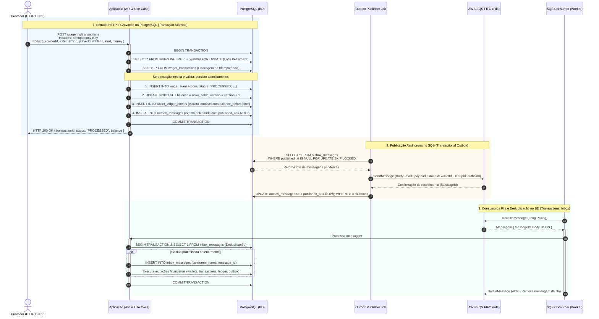
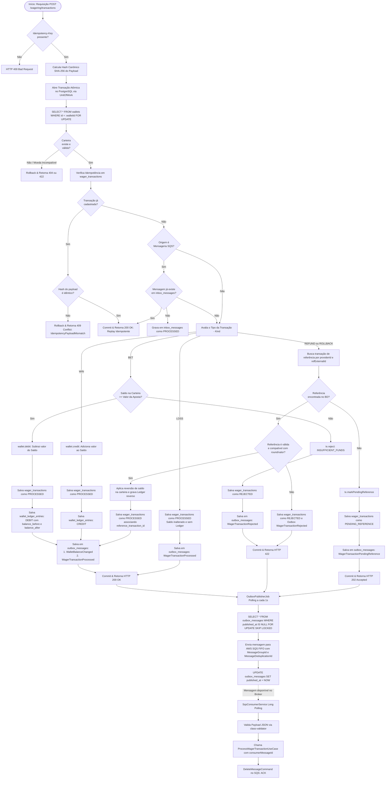

# Fluxo de Dados e Ciclo de Vida: Endpoint `POST /wagering/transactions`

Este documento detalha o fluxo completo de dados, concorrência, persistência e mensageria distribuída do endpoint **`POST /wagering/transactions`** no sistema **Distributed Wagering Processor**. 

O design do sistema adota os padrões **Transactional Outbox**, **Transactional Inbox**, **Lock Pessimista (Pessimistic Locking)** e **Consistência Contábil Imutável (Double-Entry Ledger)** sobre **PostgreSQL** e **AWS SQS FIFO**.

---

## 1. Visão Geral das Etapas

O ciclo de vida da transação compreende 4 fases principais:

1. **Recepção HTTP e Execução Atômica no Banco (Síncrono)**:
   - Validação da requisição e cálculo do hash canônico SHA-256 do payload.
   - Abertura de transação SQL única gerenciada por `UnitOfWork`.
   - Lock pessimista na carteira (`SELECT ... FOR UPDATE` em `wallets`).
   - Deduplicação e verificação de idempotência em `wager_transactions`.
   - Execução das regras financeiras específicas (`BET`, `WIN`, `LOSS`, `REFUND`, `ROLLBACK`).
   - Persistência atômica nas tabelas: `wallets`, `wager_transactions`, `wallet_ledger_entries` e `outbox_messages`.
   - Commit e retorno da resposta HTTP ao chamador (`200 OK`, `202 Accepted`, `422 Unprocessable` ou `409 Conflict`).

2. **Publicação Confiável na Fila SQS (Assíncrono — Outbox Publisher)**:
   - Polling contínuo (`OutboxPublisherJob`) buscando mensagens pendentes na tabela `outbox_messages` com `SKIP LOCKED`.
   - Envio para a fila **AWS SQS FIFO** com agrupamento estrito (`MessageGroupId = aggregateId`) e deduplicação (`MessageDeduplicationId = outbox.id`).
   - Atualização do registro na tabela `outbox_messages` com `published_at = NOW()`.

3. **Consumo de Eventos da Fila e Deduplicação no Banco (Assíncrono — SQS Consumer)**:
   - Long polling contínuo da fila SQS via `SqsConsumerService`.
   - Validação de schema do payload JSON recebido (`class-validator`).
   - Deduplicação transacional idempotente via tabela `inbox_messages` (Transactional Inbox).
   - Reexecução do caso de uso de domínio e commit atômico no banco.
   - Reconhecimento da mensagem no broker SQS (`DeleteMessageCommand` - ACK) apenas após a confirmação no PostgreSQL.

4. **Resolução de Dependências Fora de Ordem (Pending References Job)**:
   - Caso um estorno (`REFUND`/`ROLLBACK`) chegue antes da aposta original, ele é gravado como `PENDING_REFERENCE`.
   - Um job de background (`PendingReferencesJob`) reprocessa a operação assim que a aposta de referência for comitada.

---

## 2. Diagrama de Sequência Resumido (Fluxo dos Dados)

Este diagrama resume o trânsito dos dados entre a **Aplicação**, o **PostgreSQL** e o broker **AWS SQS**:



---

## 3. Diagrama de Atividades (Activity / Decision Flowchart)

O fluxograma abaixo detalha as ramificações de decisão tomadas a cada estágio do processamento:



---

## 4. Mapeamento do Fluxo de Dados e Alterações no Banco de Dados

Abaixo está o detalhamento estruturado de quais dados chegam na requisição HTTP e como cada tabela do PostgreSQL é impactada.

### 4.1. Dados de Entrada da Requisição HTTP

Endpoint: **`POST /wagering/transactions`**

| Campo | Tipo / Origem | Obrigatório | Descrição |
| :--- | :--- | :---: | :--- |
| `Idempotency-Key` | Header HTTP (`string`) | Sim | Chave única enviada pelo provedor para garantir idempotência. |
| `providerId` | Body JSON (`string`) | Sim | Identificador do provedor do jogo (ex: `"pragmatic-play"`). |
| `externalTransactionId`| Body JSON (`string`) | Sim | Identificador único da transação gerado no sistema do provedor. |
| `playerId` | Body JSON (`UUID`) | Sim | Identificador do jogador dono da carteira. |
| `walletId` | Body JSON (`UUID`) | Sim | Identificador único da carteira do jogador. |
| `roundId` | Body JSON (`string`) | Sim | Identificador da rodada de jogo associada. |
| `gameId` | Body JSON (`string`) | Sim | Identificador do jogo no provedor. |
| `kind` | Body JSON (`enum`) | Sim | Tipo de operação: `BET`, `WIN`, `LOSS`, `REFUND`, `ROLLBACK`. |
| `money.amount` | Body JSON (`string` / num) | Sim | Valor monetário no formato `NUMERIC(18, 2)` (ex: `"10.50"`). |
| `money.currency` | Body JSON (`string`) | Sim | Moeda ISO-4217 com 3 caracteres (ex: `"BRL"`). |
| `referenceExternalTransactionId` | Body JSON (`string`) | Condicional | Obrigatório para operações `REFUND` e `ROLLBACK`. Identifica a transação anterior a ser estornada. |

---

### 4.2. Alterações Realizadas no Banco de Dados (Transação SQL Atômica)

Todas as operações abaixo ocorrem sob a **mesma transação SQL** controlada pelo `UnitOfWorkPort` (`TypeOrmUnitOfWork`):

#### 1. Tabela `wallets`
* **Bloqueio Concorrente**: Bloqueada no início via `SELECT ... FOR UPDATE` (Pessimistic Write Lock), serializando qualquer operação concorrente para o mesmo `wallet_id`.
* **Alterações no Sucesso (`BET`, `WIN`, `REFUND`, `ROLLBACK`)**:
  - `balance_amount`: Atualizado aritmeticamente (subtraído no `BET`/`ROLLBACK de WIN`, somado no `WIN`/`REFUND`/`ROLLBACK de BET`).
  - `version`: Incrementado em `+1`.
  - `updated_at`: Atualizado com o timestamp corrente.
* **Invariante no Banco**: Constraint `CHECK (balance_amount >= 0)` impede saldo negativo no nível físico do banco.

#### 2. Tabela `wager_transactions`
* **Inserção do Registro da Transação**:
  - `id`: UUID gerado pela aplicação.
  - `provider_id`: Provedor requisitante.
  - `external_transaction_id`: ID externo do provedor.
  - `idempotency_key`: Chave enviada no header.
  - `payload_hash`: SHA-256 do JSON canônico para validação de reenvio idêntico vs reenvio com parâmetros modificados.
  - `wallet_id`, `player_id`, `round_id`, `game_id`, `kind`, `amount`, `currency`: Dados do negócio.
  - `status`:
    - `PROCESSED`: Se executada com sucesso.
    - `REJECTED`: Se rejeitada por violação de regra (ex: saldo insuficiente, rodada inválida).
    - `PENDING_REFERENCE`: Se a transação de referência de um estorno ainda não chegou.
  - `reference_external_transaction_id`: Preenchido em `REFUND`/`ROLLBACK`.
  - `reference_transaction_id`: FK para a transação interna quando resolvida.
  - `failure_code`: Código de erro quando rejeitada (ex: `INSUFFICIENT_FUNDS`, `INVALID_REFERENCE_TRANSACTION`).
  - `created_at` e `processed_at`: Timestamps de auditoria.

#### 3. Tabela `wallet_ledger_entries` (Extrato Contábil Imutável)
* **Inserção (Append-Only)** — Apenas quando há mutação de saldo (`BET`, `WIN`, `REFUND`, `ROLLBACK` com impacto financeiro):
  - `id`: UUID único.
  - `wallet_id`: ID da carteira.
  - `transaction_id`: FK para `wager_transactions.id`.
  - `direction`: `DEBIT` ou `CREDIT`.
  - `amount` e `currency`: Valor e moeda da transação.
  - `balance_before`: Saldo exato da carteira antes da operação.
  - `balance_after`: Saldo exato da carteira após a operação.
  - `created_at`: Data e hora da operação.
* **Invariantes no Banco**:
  - Constraint aritmética: `balance_before ± amount = balance_after`.
  - Trigger de proteção: impede qualquer `UPDATE` ou `DELETE` nesta tabela.

#### 4. Tabela `outbox_messages` (Transactional Outbox)
* **Inserção de Mensagens**:
  - `id`: UUID da mensagem.
  - `aggregate_id`: ID do aggregate (ID da carteira ou da transação), usado posteriormente como `MessageGroupId` no SQS FIFO.
  - `event_type`: Nome do evento de domínio gerado:
    - `WalletBalanceChanged`: Informa alteração do saldo com versão da carteira.
    - `WagerTransactionProcessed`: Informa conclusão da aposta/prêmio/estorno.
    - `WagerTransactionRejected`: Informa rejeição com motivo de falha.
    - `WagerTransactionPendingReference`: Informa espera por dependência fora de ordem.
  - `payload`: JSON completo com dados e metadados (`eventId`, `correlationId`, `occurredAt`, dados de negócio).
  - `attempts`: Inicia em `0`.
  - `published_at`: `NULL` (marca que o evento ainda não foi enviado ao SQS).
  - `next_attempt_at`: Data atual (`NOW()`), tornando-o elegível para publicação imediata pelo job.

#### 5. Tabela `inbox_messages` (Transactional Inbox)
* **Inserção (Apenas quando a requisição tem origem no consumidor SQS)**:
  - `consumer_name`: Identificador do consumidor (ex: `'wager-transactions-consumer'`).
  - `message_id`: ID da mensagem do SQS / `eventId`.
  - `payload_hash`: SHA-256 do payload.
  - `received_at` e `processed_at`: Timestamps de processamento.
* **Garantia**: Chave primária composta `(consumer_name, message_id)` impede duplicidade de processamento se o SQS redelivery entregar a mesma mensagem mais de uma vez.

---

### 4.3. Ciclo de Despacho na Fila SQS (`OutboxPublisherJob`)

1. O job executa a cada **1.000 ms** (1 segundo).
2. Executa a query com bloqueio pessimista sem travar outras instâncias:
   ```sql
   SELECT * FROM outbox_messages
   WHERE published_at IS NULL AND next_attempt_at <= NOW()
   ORDER BY occurred_at ASC
   LIMIT 50
   FOR UPDATE SKIP LOCKED;
   ```
3. Para cada mensagem:
   - Serializa o `payload` para JSON.
   - Envia ao AWS SQS com parâmetros FIFO:
     - `QueueUrl`: URL configurada da fila SQS FIFO.
     - `MessageBody`: JSON do evento.
     - `MessageGroupId`: `outbox_message.aggregate_id` (garante ordem estrita por carteira/transação).
     - `MessageDeduplicationId`: `outbox_message.id` (impede duplicação em janela de 5 minutos do SQS).
   - Se o SQS confirmar o recebimento (`SendMessageCommand` OK):
     ```sql
     UPDATE outbox_messages
     SET published_at = NOW()
     WHERE id = :id;
     ```
   - Se ocorrer erro (ex: indisponibilidade transitória do broker):
     ```sql
     UPDATE outbox_messages
     SET attempts = attempts + 1,
         next_attempt_at = NOW() + (exponential_backoff),
         last_error = :errorMessage
     WHERE id = :id;
     ```

---

### 4.4. Ciclo de Consumo e Execução do Evento (`SqsConsumerService`)

1. O serviço mantém um loop contínuo de **Long Polling** via `ReceiveMessageCommand` com:
   - `WaitTimeSeconds = 5`
   - `VisibilityTimeout = 30`
   - `MaxNumberOfMessages = 5`
2. Ao receber mensagens:
   - Valida a estrutura através de `SqsWagerMessageDto` e `class-validator`.
   - Se o payload estiver corrompido: registra log de erro e não confirma ACK (permitindo expiração e encaminhamento para DLQ - Dead Letter Queue).
   - Se válido, invoca o caso de uso `ProcessWagerTransactionUseCase.execute` passando `consumerName` e `consumerMessageId`.
3. O caso de uso executa com garantia atômica:
   - Consulta e insere na tabela `inbox_messages`.
   - Se já foi processada no inbox: retorna sem repetir alterações financeiras.
   - Se for nova mensagem: atualiza `wallets`, `wager_transactions`, `wallet_ledger_entries` e insere novos eventos no `outbox_messages`.
4. **Confirmação (ACK) no SQS**:
   - Apenas **após o commit bem-sucedido no PostgreSQL**, o serviço executa:
     ```typescript
     await this.client.send(
       new DeleteMessageCommand({
         QueueUrl: envConfig.sqs.queueUrl,
         ReceiptHandle: msg.ReceiptHandle,
       }),
     );
     ```
   - Se ocorrer qualquer exceção antes do commit, o `DeleteMessageCommand` não é executado. Ao fim do `VisibilityTimeout`, o SQS disponibiliza a mensagem novamente para reprocessamento.

---

## 5. Resumo das Respostas HTTP

| Código HTTP | Condição | Significado |
| :---: | :--- | :--- |
| **`200 OK`** | Transação executada com sucesso (`PROCESSED`) ou replay idêntico de transação anterior. | Operação financeira liquidada e comitada no banco de dados. |
| **`202 Accepted`** | Transação `REFUND` ou `ROLLBACK` cuja aposta original ainda não chegou (`PENDING_REFERENCE`). | A requisição foi registrada com sucesso e aguardará resolução assíncrona. |
| **`400 Bad Request`** | Header `Idempotency-Key` ausente ou campos do payload inválidos pelo DTO. | Requisição malformada. |
| **`409 Conflict`** | O mesmo `Idempotency-Key` ou `(providerId, externalTransactionId)` reenviado com parâmetros diferentes. | Conflito de integridade de idempotência (`IdempotencyPayloadMismatch`). |
| **`422 Unprocessable Entity`** | Violação de regras financeiras do domínio (ex: `INSUFFICIENT_FUNDS`, referência com rodada divergente, etc.). | A transação foi salva no banco como `REJECTED` para fins de auditoria. |
| **`500 Internal Server Error`** | Erro inesperado de banco de dados ou infraestrutura. | Falha de execução interna. |
